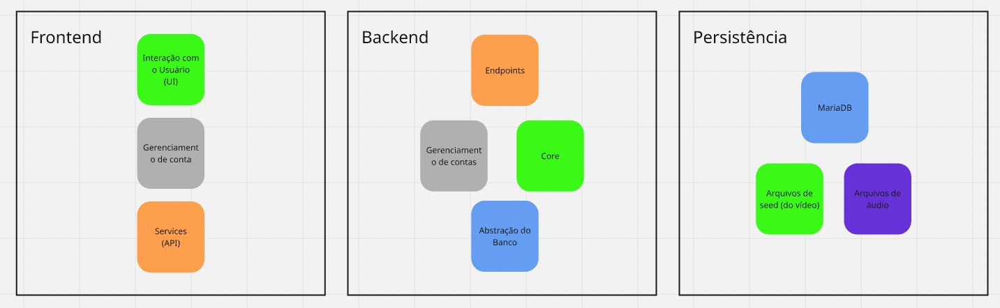

# Affectune 🎵➡️🎨
> Mapeamento de Emoções Musicais em Elementos Visuais para Acessibilidade

**Disciplina:** Projeto de Desenvolvimento de Sistemas — Engenharia da Computação  
**Orientador:** Prof. Me. Hélio Esperidião  
**Instituição:** Universidade do Vale do Paraíba (UNIVAP)  

## 👥 Integrantes da Dupla
* **Luiz Thiago Gonçalves Cassab** (Matrícula: 02310050) - ltcassab@gmail.com
* **Mateus Machado Takamatsu** (Matrícula: 02310341) - mateus.takamatsu.dev@gmail.com

---

## 📌 Sobre o Projeto
O **Affectune** é uma solução de acessibilidade computacional projetada para traduzir a experiência emocional da música para pessoas com deficiência auditiva. Utilizando **Processamento Digital de Sinais (PDS)** e **Aprendizado de Máquina**, o sistema extrai características acústicas (ritmo, frequência, tempo) e mapeia os valores de valência emocional, exibindo imagens e representações visuais correspondentes em tempo real.

---

## 🏗️ Arquitetura do Sistema
O sistema adota uma arquitetura em 3 camadas:
1. **Frontend:** Interface acessível (UI), controle de contas e consumo de APIs.
2. **Backend:** Endpoints RESTful, módulos de autenticação e o **Core** de PDS/IA.
3. **Persistência:** Banco de Dados Relacional **MariaDB**, arquivos de áudio e arquivos de seed de vídeo.

---

## 🚀 Tecnologias Utilizadas
* **Linguagens:** Python / JavaScript / C#
* **Processamento de Sinais:** Librosa / SciPy (FFT, espectrogramas)
* **Banco de Dados:** MariaDB (SQL)
* **Documentação:** Padrão INIC 2026 / Requisitos IEEE

---

## 📄 Licença e Entregáveis
Projeto acadêmico submetido ao INIC 2026. Todos os relatórios e artigos encontram-se na pasta `/docs`.
